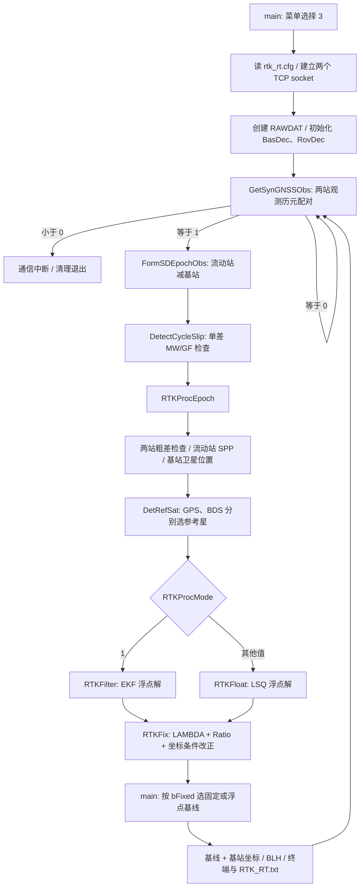

# RTK 面试学习：阅读地图

核对日期：2026-10-17。依据当前工作区源码、本地课件的 MinerU Markdown 转写和 Git 差异。这里的“已确认”指静态阅读结果；尚未重新编译或连接实时端口验证。学习材料独立保存，不改动原始程序。

## 1. 这次学什么

目标是能够在老师面前运行实时 RTK，沿着代码解释数据从哪里来、经历什么处理、结果为什么可信、失败发生在哪一层。

上学期的 SPP 推导不重新学习，但必须讲清它在 RTK 中提供的接口：流动站近似坐标、卫星位置、高度角等中间结果。

学习时每个函数按同一套问题阅读：

1. 谁调用它，调用前有哪些条件？
2. 输入是什么，单位是什么？
3. 修改了哪个对象的哪些成员？
4. 分支条件是什么意思，提前返回代表什么？
5. 下游怎样使用结果？
6. 老师追问时，能否指着对应语句解释？

## 2. Git 核对后的学期边界

最新提交：`17c075474b615f0ea796caa58499c2f59ec9ca60`，2026-05-30，提交说明 `Update core SPP source code`。

因此当前 `HEAD` 可以作为上学期代码的对照基线；并不是每一个未提交文件都属于 RTK，需要按用途判断。

| 文件 | 与 HEAD 相比 | 本学期阅读重点 |
|---|---|---|
| `RTK_CSH/main.cpp` | 已修改 | 增加菜单 2/3，配置、双流初始化、同步、调用 RTK 与输出 |
| `RTK_CSH/Data_IO.cpp` | 新增、未跟踪 | 配置解析、文件/TCP 读取、两站观测历元配对 |
| `RTK_CSH/Decoding.cpp` | 已修改 | 共享消息解析器、两份解码上下文、BESTPOS 接入与统计 |
| `RTK_CSH/RTK_RelPos.cpp` | 新增、未跟踪 | 单差、周跳、参考星、LSQ、EKF、LAMBDA 固定接口 |
| `RTK_CSH/RTK_Structs.h` | 已修改 | 双流上下文、浮点结果、滤波状态、基站坐标等数据组织 |
| `RTK_CSH/lambda.cpp` | 新增、未跟踪 | 整数搜索模块；文件头标注 T. Takasu，讲清引用模块和自写集成部分 |
| `RTK_CSH/SPP_SPV.cpp` | 少量修改 | 回填高度角、方位角、对流层改正，低高度角卫星位置标志失效 |
| `RTK_CSH/matrix_inv.cpp` | 少量修改 | 主元索引数组容量从 60 调整为 250，原注释未同步 |
| `RTK_CSH/RTK_CSH.vcxproj` | 已修改 | 将新增 cpp 纳入编译 |
| `RTK_CSH/rtk.cfg`、`rtk_rt.cfg` | 新增、未跟踪 | 当前分别配置文件+LSQ、TCP+EKF |

`sockets.cpp`、`Sat_pos.cpp`、`Coord_trans.cpp`、`Time_trans.cpp` 是依赖模块，按 RTK 调用点阅读，不重新把上学期全部展开。

## 3. 当前程序的真实主线



图中省略了各解算函数内部的失败返回；不能据此理解为有同步数据就一定能得到解。

同步函数内部还有一条链：

```text
GetSynGNSSObs
  → WaitReadable（TCP 模式）
  → PumpStream
      → fread 或 recv
      → FeedNovData
      → DecodeNovStream
          → ParseNovMsg：找帧头、检查长度、CRC、分派消息
              42   → decode_bestpos → 基站坐标候选
              43   → decode_rangeb_oem7 → 一站一个观测历元
              7    → decode_gpsephem → GPS 星历
              1696 → decode_bdsephem → BDS 星历
  → PairEpoch：比较两站观测时间
```

## 4. 推荐分讲顺序

| 讲次 | 核心问题 | 源码入口 |
|---|---|---|
| 01 | 按下 3 后程序怎样运行？一条输出怎样形成？ | `main.cpp:293`，`RTKProcEpoch:300` |
| 02 | RAWDAT 里究竟装着什么？谁拥有、谁修改、能活多久？ | `RTK_Structs.h:171/227/244/278/292/324/386/415/435` |
| 03 | TCP 字节如何进入缓冲区？为什么会有半帧、多个完整帧？ | `Data_IO.cpp:78/95`，`Decoding.cpp:36/135/150` |
| 04 | 一帧如何变成 P/L/D、星历、基站 XYZ？ | `Decoding.cpp:156/260/311/357` |
| 05 | 两站为什么要同步？早了读谁、晚了读谁？ | `Data_IO.cpp:68/124/158` |
| 06 | 单差怎么配卫星？半周、LockTime、MW/GF 怎样共同筛选？ | `RTK_RelPos.cpp:20/92` |
| 07 | 怎样选 GPS/BDS 参考星？nBas、nRov、RefPos 有何区别？ | `RTK_RelPos.cpp:169/300` |
| 08 | 双差方程怎样落成 B、W、权阵？LSQ 如何迭代？ | `RTK_RelPos.cpp:368` |
| 09 | EKF 保留什么历史？换参考星、升降星、周跳后如何处理？ | `RTK_RelPos.cpp:694/709` |
| 10 | 浮点模糊度怎样固定？Ratio 是什么？固定后坐标如何改变？ | `RTK_RelPos.cpp:1077`，`lambda.cpp:192` |
| 11 | 实时演示、定位异常、现场指代码和模拟问答 | 回到配置、入口、各个提前返回点 |

每讲都结合小例子和具体变量，不要求一次背下整个工程。01 已有单独讲义，后续逐讲展开。

## 5. 课件与源码对应

课件在 `C:\Users\asus\DeskBox\我的桌面\GNSS_RTK_2`。当前主要依据各目录内已有的 `MinerU_markdown_*.md`；公式有 OCR 转写风险，需要推导时再对照原课件。

| 本学期课件 | 对应源码 |
|---|---|
| 2-1 总体设计 | main、配置、RAWDAT、数据输入、消息解析、同步与 SPP 接口 |
| 2-2 站间单差 | FormSDEpochObs、DetectCycleSlip |
| 2-3 基准星选取 | DetRefSat |
| 2-4 相对定位 | RTKFloat、RTKFilter |
| 2-5 模糊度固定 | RTKFix、lambda |

成果要求的转写明确要求连接网络端口、运行实时 RTK、展示代码并回答问题，与本次学习目标一致。资料中的实时 IP/端口与当前 `rtk_rt.cfg` 一致；端口当前是否在线尚未验证。

## 6. 先记住这些约定

| 名称 | 当前工程中的含义 |
|---|---|
| `Bas` / `Rov` | 基站 / 流动站 |
| `Epk` | 一个观测历元，按接收机观测时间组织 |
| `SD` / `DD` | 站间单差 / 站星双差 |
| `P` / `L` | 伪距 / 载波相位距离；解码后均为米 |
| `D` | 多普勒经波长和符号转换后的量，不再是原始 Hz |
| `freq=0/1` | GPS L1/L2；BDS B1I/B3I，不能统一理解成 L1/L2 或 B1/B2 |
| `FloatAmb` | 双差模糊度，单位周；相位方程中乘波长转成米 |
| `dPos` | 输出结果中的基线 XYZ，流动站减基站；不要与迭代坐标改正 dx 混淆 |
| `dNeu` | 基站当地坐标系内的基线，数组顺序 N、E、U |
| `RefPrn` / `RefPos` | 参考星 PRN / 参考星在单差卫星数组内的下标 |
| `nBas` / `nRov` | 同一单差卫星在基站 / 流动站原观测数组中的下标 |

## 7. 原有图表的使用边界

`reports/DRAWIO_REPORT.md` 中仍有“RTK 下游未实现”“InitNovDecoder 未调用”“ReadRTKConfigInfo 未调用”等旧描述，已与当前源码不一致。因此旧图可帮助回忆输入层，但不能直接作为当前完整 RTK 实现的证据。本目录按当前源码另建阅读材料。

## 8. 本轮学习进度

- 已核对：Git 基线、核心模块、配置、课件主题、RTK 主调用链。
- 已准备：01 实时入口精读讲义、当前实现的易误读项。
- 尚未进行：重新构建、实时端口连接、当前源码端到端数值验证。
- 下一讲：先读 RAWDAT 的数据归属与生命周期，再沿 PumpStream 下钻到解码；第一讲掌握后继续即可。
